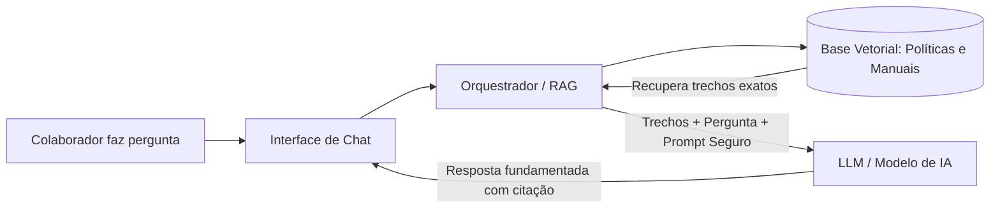

# Estudo de Viabilidade e Planejamento: Chatbot Interno Corporativo (RAG)

Este documento reúne o levantamento arquitetural, comparativo de infraestrutura e o preenchimento detalhado das questões de ideação e MVP para a submissão e execução do projeto.

---

## 1. Levantamento de Abordagens Tecnológicas

O padrão arquitetural indispensável para este projeto é o **RAG (Retrieval-Augmented Generation)**. Ele permite que o modelo responda estritamente baseado nos documentos internos da empresa, eliminando alucinações e evitando a necessidade de treinamento ou fine-tuning dispendioso.

Abaixo, a comparação entre as opções de execução:

---

### Opção 1: Execução 100% Local (1 PC / On-Premise)

Nesta modalidade, o modelo de linguagem (LLM), o banco vetorial e o mecanismo de busca rodam inteiramente dentro do hardware da empresa, sem que nenhum byte de documento saia da rede local.

* **Motor de Inferência**: [Ollama](https://ollama.com/), vLLM ou LM Studio Server.
* **Modelos Recomendados (LLMs)**:
  * `Llama 3.1 8B` (Meta) ou `Qwen 2.5 7B / 14B` (Alibaba) quantizados em 4 ou 8 bits.
  * *Embeddings*: `nomic-embed-text` ou `bge-m3` (excelente para português).
* **Banco de Vetores Local**: ChromaDB, FAISS ou LanceDB.
* **Orquestração**: Python (LangChain ou LlamaIndex) + FastAPI + Interface Web (Streamlit ou Open WebUI).
* **Vantagens**:
  * **Segurança e Privacidade Absoluta**: Cumpre integralmente LGPD e exigências de sigilo bancário/corporativo sem risco de tráfego de dados externo.
  * **Custo Operacional Zero em Tokens**: Não há cobrança por mensagem enviada.
* **Desvantagens**:
  * **Gargalo de Concorrência**: Um único computador aguenta apenas 1 a 3 requisições simultâneas sem enfileiramento severo.
  * **Custo de Hardware**: Exige máquina com GPU dedicada com boa VRAM (mínimo 12GB–16GB VRAM, e.g., RTX 3060 12GB ou RTX 4070+).
  * **Janela de Contexto Limitada**: Processamento de documentos muito longos pode ser mais lento.

---

### Opção 2: Nuvem Comercial via APIs (Web / SaaS)

Aqui, a lógica do chatbot e o banco de vetores enviam apenas os trechos pertinentes dos documentos para uma API de IA de última geração.

* **Modelos Recomendados (LLMs)**:
  * `Gemini 1.5 Flash` / `Gemini 2.0 Flash` (Google) ou `GPT-4o-mini` (OpenAI).
  * *Embeddings*: `text-embedding-004` (Google) ou `text-embedding-3-small` (OpenAI).
* **Banco de Vetores**: Supabase (com extensão `pgvector`), Qdrant Cloud ou ChromaDB gerenciado.
* **Orquestração**: Next.js / Python FastAPI consumindo SDKs oficiais.
* **Vantagens**:
  * **Qualidade de Resposta Superior**: Modelos de ponta entendem nuances complexas de políticas e manuais em português com precisão cirúrgica.
  * **Janelas de Contexto Gigantes**: O Gemini, por exemplo, suporta de 1M a 2M de tokens, permitindo alimentar múltiplos manuais inteiros se necessário.
  * **Custo de Prototipagem Irrisório**: Modelos como Flash e 4o-mini custam frações de centavos por milhão de tokens (menos de R$ 5,00 para todo o período de testes).
  * **Infraestrutura Zero**: Roda em qualquer máquina simples ou hospedagem gratuita (Vercel, Render, Cloud Run).
* **Desvantagens**:
  * **Conformidade/Políticas da Empresa**: Requer validação jurídica interna (embora APIs pagas corporativas garantam contratualmente que não usam os dados para treinar modelos).
  * Dependência de conectividade com a internet.

---

### Opção 3: Abordagens Alternativas (Low-Code / Híbrida / Managed)

1. **Plataformas RAG Low-Code / No-Code (Dify / Flowise / AnythingLLM)**:
   * **Como funciona**: Aplicação web self-hosted ou cloud com interface drag-and-drop. Conecta-se a PDFs, cria o índice vetorial e fornece um widget de chat pronto para embedar em sites internos ou intranet.
   * **Por que considerar**: **Ideal para validar o MVP em menos de 24 horas**, suportando tanto Ollama local quanto APIs em nuvem.
2. **Solução Híbrida**:
   * O banco de vetores e a anonimização de dados rodam localmente (mascarando CPF, nomes e valores salariais sensíveis), enquanto as perguntas descaracterizadas são respondidas por APIs de nuvem de alta velocidade.
3. **Plataformas Enterprise Gerenciadas (Google Vertex AI Agent Builder / AWS Bedrock)**:
   * Plataformas "turn-key" empresariais que indexam repositórios (Google Drive, SharePoint, S3) nativamente com permissões de acesso por perfil (RBAC). Indicado para fase pós-MVP.

---

### 4. Matriz Comparativa de Infraestrutura

| Critério | Opção 1: Local (1 PC / On-Premise) | Opção 2: Nuvem via API (Gemini/OpenAI) | Opção 3: Low-Code (Dify / AnythingLLM) |
| :--- | :--- | :--- | :--- |
| **Hardware Necessário** | PC com GPU (Nvidia RTX 3060 12GB+ ou Mac Apple Silicon 16GB+ RAM) | Qualquer computador modesto (notebook i3/i5 com 8GB RAM) | Máquina modesta (Docker) ou Cloud gratuita |
| **Custo Inicial (Setup)** | Alto (se precisar adquirir a máquina: R$ 5.000 a R$ 10.000) | Praticamente R$ 0 | R$ 0 |
| **Custo Operacional Mensal** | Energia elétrica | Pago por uso (estimado < R$ 30/mês para protótipo) | Custo de API ou R$ 0 local |
| **Complexidade de Engenharia** | Média-Alta (gerenciar drivers CUDA, quantização, inferência) | Média-Baixa (uso de SDKs padronizados) | Muito Baixa (interface visual configurável) |
| **Latência por Resposta** | 3 a 10 segundos (depende do tamanho do modelo e GPU) | 0.8 a 2.5 segundos | 1 a 3 segundos (com API) |
| **Privacidade dos Dados** | Máxima (nada sai da rede local) | Elevada (sob termos de API comercial B2B) | Depende do modelo conectado |
| **Escalabilidade** | Baixa (1 máquina atende poucos acessos por minuto) | Quase infinita (auto-escalável) | Média/Alta |

---

## 2. Respostas ao Formulário de Inscrição / Canvas do Projeto

Abaixo estão as respostas estruturadas para o formulário de submissão do projeto, com justificativas e comentários práticos.

### Pergunta 1: Identificação da Oportunidade
> **Qual é o problema específico que o longo tempo de busca por documentação interna causa para os colaboradores e para a empresa (custo, produtividade, frustração)?**

* **Resposta Proposta**:
  O problema central reside na **fragmentação e dispersão da informação corporativa**. Em empresas em crescimento ou consolidadas, documentos essenciais (políticas de RH, normas de compliance, procedimentos operacionais e FAQs de TI) encontram-se espalhados em intranets legadas, pastas de rede, e-mails ou murais internos.

  As consequências diretas se dividem em três esferas críticas:
  1. **Produtividade e Custo Oculto**: Estudos indicam que um colaborador gasta em média de 1,5 a 2 horas por dia procurando informações para realizar seu trabalho. Multiplicando essa perda pelo custo/hora de centenas de colaboradores, a empresa perde milhares de horas produtivas mensais em tarefas de busca e retrabalho.
  2. **Sobrecarga dos Times de Backoffice (RH, DP e TI)**: Gestores e profissionais de suporte dedicam até 40% do seu tempo respondendo repetidamente às mesmas dúvidas básicas (ex.: prazos para solicitação de férias, reembolso de despesas, cobertura do plano odontológico, procedimentos de atestado médico).
  3. **Frustração e Risco de Não Conformidade**: A dificuldade de encontrar respostas rápidas gera ruído na comunicação interna, atrito na jornada do colaborador (especialmente novos contratados em *onboarding*) e risco de decisões tomadas com base em versões desatualizadas de manuais e políticas.

> [!NOTE]
> **Comentário Estratégico:**
> Enfatizar o cálculo de ROI (*Return on Investment*). No Canvas do projeto, posicione o chatbot não como um "brinquedo tecnológico", mas como um **otimizador de eficiência operacional** que desafoga os analistas de RH e empodera o colaborador com respostas instantâneas (de 15 minutos de busca para 5 segundos de leitura).

---

### Pergunta 2: Público-Alvo e Necessidades
> **Quem são os usuários primários (quais departamentos ou cargos) e quais são os tipos mais comuns de perguntas que eles fariam ao chatbot?**

* **Resposta Proposta**:
  * **Usuários Primários**:
    1. **Novos Colaboradores (Fase de Onboarding)**: Profissionais nos primeiros 90 dias de empresa que não conhecem a cultura, os sistemas e as regras internas.
    2. **Colaboradores em Geral (CLT / Terceirizados)**: Equipes operacionais, administrativas e comerciais que precisam consultar direitos, prazos e rotinas de trabalho.
    3. **Lideranças e Gestores de Equipe**: Precisam consultar políticas para orientar seus liderados (regras de promoção, aplicação de feedbacks, concessão de benefícios, escala de férias).
    4. **Equipes de Suporte Interno (RH / DP / TI)**: Utilizam o bot como ferramenta de segundo nível para conferir rapidamente redações de normas oficiais.

  * **Tipos Mais Comuns de Perguntas**:
    * *Benefícios e Remuneração*: "Qual é a coparticipação do plano de saúde em consultas?", "Como funciona o auxílio-creche e qual a documentação necessária?"
    * *Jornada e Ausências*: "Até quando posso solicitar minhas férias de fim de ano?", "Qual é o prazo limite para envio de atestado médico e para quem devo enviar?"
    * *Rotinas Corporativas e Reembolso*: "Qual é o valor limite para jantar em viagens de trabalho?", "Qual é o canal para solicitar troca de notebook ou periféricos?"
    * *Ética e Conduta*: "A empresa permite trabalho remoto fora do estado?", "Qual é o dress code para atendimento a clientes?"

> [!TIP]
> **Comentário Prático:**
> Na fase de protótipo, foque primeiro nas perguntas de **alto volume e baixa complexidade**. Essas são as perguntas que mais roubam tempo do time de RH e que apresentam respostas objetivas dentro dos manuais existentes.

---

### Pergunta 3: Arquitetura do Protótipo
> **Qual tecnologia de Processamento de Linguagem Natural (PLN) ou modelo de IA é o mais viável para a prova de conceito (ex: modelos open-source, APIs) e como ela será integrada à base de documentos?**

* **Resposta Proposta**:
  Para a **Prova de Conceito (PoC)**, a tecnologia mais viável e ágil é o uso de **APIs de ponta em Nuvem combinadas com RAG (ex: Google Gemini 1.5/2.0 Flash ou OpenAI GPT-4o-mini)**, com a alternativa de contorno local via **Ollama (Llama 3.1 8B)** caso a empresa possua política restritiva de envio de dados para servidores externos.

  * **Justificativa de Viabilidade**:
    * Treinar ou fazer fine-tuning de modelos locais para um protótipo tem alto custo e não resolve o problema de atualização de documentos.
    * As APIs modernas oferecem custo quase nulo durante testes (< R$ 10,00 no total), latência inferior a 2 segundos, suporte nativo avançado a português e excelente capacidade de seguir instruções restritas (*guardrails*).

  * **Fluxo de Integração com a Base de Documentos (RAG Pipeline)**:
    1. **Ingestão e Extração**: Os documentos (PDFs, DOCX, Markdown) são extraídos preservando títulos e seções estruturadas.
    2. **Chunking (Segmentação)**: Os textos são fracionados em blocos lógicos (chunks de 500 a 800 tokens com overlap de 100 tokens), evitando cortar parágrafos no meio de regras cruciais.
    3. **Vetorização (Embeddings)**: Cada trecho é convertido em um vetor semântico através de um modelo de embeddings (`text-embedding-004` ou `bge-m3`).
    4. **Armazenamento**: Os vetores são indexados em um banco vetorial leve (ChromaDB ou Supabase pgvector).
    5. **Recuperação e Geração (Prompt Augmentation)**: Quando o colaborador faz uma pergunta, o sistema busca os 3 a 5 trechos mais similares no banco vetorial e injeta-os em um prompt seguro:
       > *"Você é o Assistente Virtual Corporativo. Responda à pergunta do colaborador utilizando ÚNICA E EXCLUSIVAMENTE os trechos de documentos fornecidos abaixo. Se a informação não constar explicitamente nos trechos, responda educadamente que o documento não aborda o tema e oriente o colaborador a abrir um chamado no RH. Cite sempre a página ou seção do documento."*

> [!IMPORTANT]
> **Comentário Arquitetural:**
> O grande diferencial do RAG sobre uma IA genérica é a **citabilidade**. O bot não deve apenas dar a resposta: ele deve dizer *"Conforme item 4.2 da Política de Férias (pág. 6)..."*. Isso gera confiança imediata na equipe de governança.

---

### Pergunta 4: Definição do Escopo (MVP da Ideação)
> **Quais são os 3 documentos internos mais cruciais que o chatbot deverá ser capaz de processar e responder na fase de prototipação?**

* **Resposta Proposta**:
  Para garantir validação rápida com impacto palpável, os 3 documentos selecionados são:

  1. **Política de Férias e Ausências**:
     * *Justificativa*: Trata de temas de alto interesse com datas, prazos rigorosos, fracionamento de períodos e procedimentos formais. Excelente para testar se a IA é capaz de ler regras condicionais precisas (ex: abono pecuniário, prazo de 30 dias de antecedência).
  2. **Guia de Benefícios Corporativos (Saúde, Odonto, Vale-Refeição/Alimentação, Auxílios)**:
     * *Justificativa*: Representa a maior volumetria de dúvidas diárias no RH. Testa a habilidade do bot de diferenciar categorias (ex: estagiário vs CLT) e tabelas de valores/coparticipação.
  3. **Manual de Onboarding e Normas de Conduta / TI (Uso de Equipamentos e Trabalho Remoto)**:
     * *Justificativa*: Cobre regras de segurança da informação, suporte a equipamentos, trabalho híbrido/remoto e canais oficiais para solicitação de acessos. Garante testes para novos colaboradores.

> [!TIP]
> **Comentário de Escopo:**
> Manter o MVP estritamente nestes 3 documentos evita o erro clássico de tentar indexar centenas de arquivos na primeira semana. A squad consegue auditar manualmente 100% das respostas geradas pelo bot contra estes 3 manuais antes de liberar para os primeiros usuários de teste.

---

### Pergunta 5: Métricas de Sucesso
> **Como será medida a eficácia do protótipo (ex: taxa de acerto nas respostas, velocidade de resposta, satisfação do usuário em testes iniciais)?**

* **Resposta Proposta**:
  A validação do protótipo será acompanhada por 4 dimensões quantitativas e qualitativas:

  1. **Acurácia e Fidelidade ao Conteúdo (Factualidade / Taxa de Alucinação)**:
     * *Meta*: **>= 90%** de acerto em um conjunto de teste com 50 perguntas controladas elaboradas previamente pelo time de RH.
     * *Taxa de Alucinação tolerada*: **0%** (o bot prefere responder "não encontrei no documento" a inventar uma regra corporativa).
  2. **Velocidade de Resposta (Latência)**:
     * *Meta*: Tempo médio de resposta entre **1.5 e 4.0 segundos** (tempo aceitável para experiência de chat fluida).
  3. **Satisfação do Usuário (CSAT Interno e Feedback Micro)**:
     * *Métrica*: Mecanismo de reação rápida no chat (👍 / 👎) com campo opcional de motivo.
     * *Meta*: **>= 80%** de aprovação nos testes com o grupo piloto (20 a 30 colaboradores voluntários).
  4. **Tempo Economizado Estimado**:
     * *Métrica*: Redução do tempo medido de busca (comparativo entre a busca manual em PDFs e a resposta do chatbot + clique na fonte citada). Redução esperada de mais de 70% no tempo despendido por consulta.

---

## 3. Recomendações Práticas para a Squad

1. **Semana 1 - Preparação dos Dados**:
   * Transforme os 3 PDFs/manuais em texto limpo (Markdown) para facilitar o chunking.
2. **Semana 2 - Protótipo Funcional (PoC)**:
   * Comece com uma interface rápida (Streamlit ou Dify/Flowise) conectada a uma API de baixo custo (Gemini Flash ou GPT-4o-mini). Isso permite demonstrar valor para os stakeholders em poucos dias.
3. **Semana 3 - Avaliação com Usuários Reais**:
   * Libere o link do protótipo para uma squad ou grupo piloto restrito com os 3 manuais carregados e colete os feedbacks 👍/👎.
4. **Semana 4 - Consolidação do Canvas**:
   * Apresente os resultados comparando o tempo de resposta do bot vs tempo do colaborador procurando no manual.
