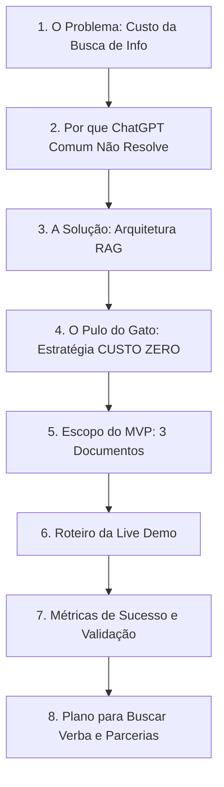
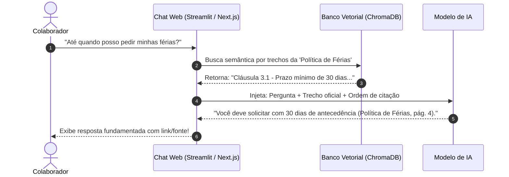

# Apresentação do Projeto: Assistente Virtual Corporativo com IA (RAG)

**Público-Alvo**: Professor orientador e colegas de turma (Squad).  
**Objetivo**: Aprovar o projeto, engajar a squad e provar que a falta de verba inicial e de servidores na faculdade não é um impedimento, mas sim uma oportunidade de demonstrar engenharia inteligente e inovação frugal.

---

## Estrutura da Apresentação (Pitch Deck)

---

### Slide 1: Capa e Gancho de Impacto
* **Título**: **DocAI: O Fim das Horas Perdidas Procurando Documentos Internos**
* **Subtítulo**: Prova de Conceito de um Assistente de Inteligência Artificial para Documentação Corporativa
* **Autores**: [Nome dos Integrantes da Squad]
* **Mensagem-chave**: *"Em uma empresa, a informação existe, mas ninguém acha. Vamos resolver isso com IA sem gastar 1 real no protótipo."*

> [!TIP]
> **O que falar na apresentação:**  
> *"Professor e colegas, vocês sabiam que um funcionário corporativo médio gasta quase 2 horas por dia apenas procurando informações para conseguir trabalhar? Políticas de férias, regras de reembolso, guias de benefícios... tudo está soterrado em PDFs que ninguém lê. Nosso projeto cria um assistente inteligente que encontra e responde a qualquer dúvida de manual em 2 segundos."*

---

### Slide 2: O Problema Real nas Empresas (A Dor do Negócio)
* **Visual**: Gráfico simples ou 3 caixas de dor:
  1. **Tempo Desperdiçado**: Colaboradores e novatos em onboarding demoram horas para achar regras simples.
  2. **Sobrecarga do RH / TI**: Profissionais seniores gastam até 40% do expediente repetindo as mesmas respostas por mensagem.
  3. **Risco de Erro (Desalinhamento)**: Decisões tomadas com base em manuais desatualizados ou no "ouvi dizer".
* **Impacto Financeiro**: Uma empresa com 100 funcionários perde mais de R$ 50.000/mês apenas com ineficiência de busca de informação.

> [!TIP]
> **O que falar na apresentação:**  
> *"Isso não é só um incômodo, é um custo invisível gigantesco. E quem mais sofre é quem entra agora na empresa e o RH, que virou uma central de atendimento humana para ler PDF."*

---

### Slide 3: Por que o "ChatGPT Comum" não resolve?
* **Tabela de Comparação**:

| Critério | ChatGPT / IA Genérica | Nossa Solução com RAG |
| :--- | :--- | :--- |
| **Conhecimento das regras da empresa** | Zero (não conhece a empresa) | Total (restrito aos documentos internos) |
| **Risco de Alucinação (Inventar dados)** | Alto (responde o que 'acha') | Praticamente Zero (baseia-se em trecho real) |
| **Citação de Fontes** | Não cita páginas oficiais | Cita página, cláusula e manual exato |
| **Segurança e Privacidade** | Risco de vazamento público | Base restrita e controlada |

> [!TIP]
> **O que falar na apresentação:**  
> *"Se você perguntar ao ChatGPT tradicional sobre o plano de saúde da empresa X, ele vai inventar uma resposta bonita, mas falsa. É por isso que o mercado adotou o RAG (Retrieval-Augmented Generation). Nosso bot só fala o que está escrito nos documentos oficiais."*

---

### Slide 4: A Arquitetura RAG (Como a Mágica Acontece)
* **Diagrama Visual do Pipeline**:

---

### Slide 5: O Pulo do Gato – Estratégia CUSTO ZERO e Sem Servidores
> [!IMPORTANT]
> **Este é o slide decisivo para convencer o professor e a turma:**

* **A Objeção da Banca**: *"A faculdade não tem servidores com GPU e a squad não tem verba."*
* **A Nossa Solução de Engenharia**:
  1. **Prototipagem com Recursos Gratuitos (Free Tiers)**:
     * Utilização do **Google Gemini API Free Tier** ou **Groq Cloud (Llama 3.1 em alta velocidade)**: Custo R$ 0,00 para milhares de requisições durante a fase acadêmica.
     * Banco de dados vetorial embutido e sem custo (ChromaDB local ou Supabase Free Tier).
  2. **Ambiente de Demonstração (Live Demo)**:
     * A execução do protótipo e dos testes iniciais é hospedada na máquina pessoal de um dos integrantes durante a apresentação, sem custos para a universidade.
  3. **Validação Antes do Investimento**:
     * Em metodologias ágeis de produto, **nenhuma empresa séria investe em hardware caro antes de validar a Prova de Conceito (PoC)**. A nossa falta de verba inicial se torna uma virtude metodológica: validar com custo zero primeiro.

> [!TIP]
> **O que falar na apresentação:**  
> *"Professor, muitas equipes travam porque acham que precisam de R$ 20 mil em servidores ou GPUs dedicadas logo no primeiro dia. Nós adotamos a mentalidade do mercado de tecnologia: inovação frugal. Usamos créditos gratuitos e camadas free para provar que a arquitetura funciona e que as métricas são reais. Uma vez validada a PoC, temos os números necessários para buscar fomento ou apresentar a empresas parceiras."*

---

### Slide 6: Escopo do MVP (Os 3 Documentos de Teste)
* **Critério de Escolha**: Alto volume de dúvidas e regras claras para validação precisa.
1. **Política de Férias e Ausências**:
   * Testa regras com datas, prazos e exceções (ex.: abono pecuniário, atestados médicos).
2. **Guia de Benefícios (Saúde, Refeição, Transporte)**:
   * Testa distinções de perfis (estagiário vs CLT) e tabelas de coparticipação.
3. **Manual de Onboarding e Normas de TI**:
   * Testa orientações sobre equipamentos, home office e segurança digital para novos contratados.

---

### Slide 7: Roteiro da Demonstração Prática (Live Demo na Apresentação)
* **Cenário 1 (Pergunta Clara)**:
  * Pergunta: *"Qual o prazo para envio do atestado de saúde?"*
  * Resposta esperada: Citação exata do prazo de 48h com o item do regulamento.
* **Cenário 2 (Tentativa de Pegadinha / Alucinação)**:
  * Pergunta: *"A empresa reembolsa almoço aos domingos em dias de folga?"*
  * Resposta esperada: *"Não encontrei menção a esse benefício nos documentos internos. Por favor, consulte o RH."* (Mostra segurança contra alucinações).
* **Cenário 3 (Filtro por Perfil)**:
  * Pergunta: *"Estagiário tem direito a vale-alimentação nas férias?"*
  * Resposta esperada: Verificação das cláusulas contratuais de estágio.

---

### Slide 8: Como Mediremos o Sucesso (Métricas Acadêmicas e de Negócio)
* **Taxa de Acurácia**: >= 90% em uma bateria de 30 perguntas formuladas previamente com gabarito.
* **Taxa de Alucinação**: 0% (o sistema prefere dizer "não consta no manual" do que inventar).
* **Tempo Médio de Resposta**: < 3 segundos por pergunta.
* **Avaliação de Usuários (Piloto com alunos/professores)**: Formulário simples com métrica CSAT (>= 80% de satisfação).

---

### Slide 9: Plano de Captação e Próximos Passos (Como Obter Verba)
* **Fase 1 (Atual - Prototipagem)**: Validação técnica com custo R$ 0,00 na máquina pessoal + Free Tier.
* **Fase 2 (Artigo / Iniciação Científica / TCC)**: Apresentação dos dados de acurácia e redução de tempo.
* **Fase 3 (Captação de Recursos)**:
  * Editais internos da faculdade (bolsas de inovação e pesquisa aplicada).
  * Pitch para empresas júnior ou convênio com empresas parceiras locais (oferecer piloto gratuito em troca de infraestrutura em nuvem patrocinada).
  * Programas de créditos educacionais (AWS Educate, Google Cloud for Students, GitHub Student Pack que fornecem US$ 100 a US$ 300 em nuvem).

---

### Slide 10: Divisão da Squad e Conclusão
* **Divisão de Papéis na Squad**:
  * *Engenharia de Dados & Parsing*: Limpeza e chunking dos 3 documentos PDFs.
  * *IA & Pipeline RAG*: Configuração da base vetorial e prompts com guardrails.
  * *Frontend & Experiência*: Criação da interface simples e elegante de chat.
  * *Qualidade & Testes*: Elaboração das perguntas de teste e auditoria de respostas.
* **Conclusão**:
  * *"Temos a tecnologia, temos a estratégia de custo zero e temos o planejamento pronto para executar. Queremos a aprovação de vocês para começarmos o desenvolvimento da PoC."*

---

## Dicas Extras: Como Responder às Perguntas Difíceis do Professor

1. **"E a LGPD? Onde ficam os dados?"**
   * *Resposta*: *"Para este protótipo, utilizamos documentos públicos/institucionais sem nenhum dado pessoal sensível (como CPFs ou salários individuais). No roadmap para produção, a arquitetura foi desenhada para permitir rodar 100% on-premise com modelos locais (como Llama 3.1 via Ollama) caso a política de segurança da empresa exija que nenhum dado trafegue pela internet."*

2. **"E se o modelo errar ou inventar uma regra de férias que prejudique o funcionário?"**
   * *Resposta*: *"Esse é o grande diferencial do RAG com engenharia de prompt restritiva. Definimos o parâmetro de temperatura do modelo próximo de zero e forçamos a exigência de citação exata da fonte. Se o texto recuperado não contiver a resposta, o bot é instruído a admitir a falta de informação e fornecer o contato do canal humano de RH."*

3. **"Como vocês garantem que qualquer pessoa da turma consiga rodar?"**
   * *Resposta*: *"Desenvolveremos uma aplicação leve em Python com container Docker ou script de instalação em 1 clique, garantindo que qualquer membro da squad com um notebook convencional consiga testar e colaborar."*
