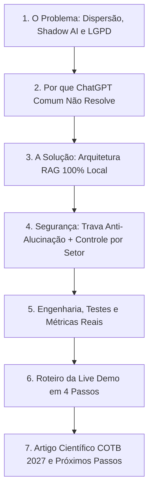

# Pitch de Apresentação: DocAI — Assistente Corporativo Inteligente com RAG Local

**Projeto**: DocAI: Assistente Corporativo Inteligente Baseado em Arquitetura RAG Local  
**Autores**: Tiago A. Ventura e Jorge Werner (orientador) — Unisul (Análise e Desenvolvimento de Sistemas)  
**Estágio atual**: MVP Nível 2 concluído, validado e acompanhado de artigo científico (Unisul / COTB 2027)  
**Duração sugerida do pitch**: 5 minutos (apresentação + demonstração ao vivo)

---

## Estrutura da Apresentação (Pitch Deck)



---

### Slide 1: Capa e Gancho de Impacto (0:00 – 0:35)
* **Título**: **DocAI: Soberania de Dados e Precisão Normativa com RAG 100% Local**
* **Subtítulo**: Assistente Corporativo com Ollama, ChromaDB, LangChain e Streamlit
* **Mensagem-chave**: *"Informação interna não pode vazar para a nuvem e IA corporativa não pode inventar regras. O DocAI responde com fonte e cláusula exata, 100% dentro da rede da empresa e com custo recorrente zero."*

> [!TIP]
> **Fala sugerida:**  
> *"Colaboradores gastam cerca de 20% da jornada semanal procurando normas espalhadas em manuais de RH, benefícios e TI. Para ganhar tempo, muitos colam documentos internos em IAs comerciais na nuvem — criando o risco de Shadow AI e violação à LGPD. Nós construímos o DocAI: um assistente corporativo que roda 100% local, cita documento e cláusula exata e bloqueia alucinações por código."*

---

### Slide 2: As Três Dores Corporativas (0:35 – 1:10)
1. **Produtividade Perdida**: Normas dispersas geram consultas lentas, sobrecarga repetitiva em RH/TI e risco de decisões com base em versões antigas.
2. **Shadow AI e Risco LGPD (Lei nº 13.709/2018)**: Enviar políticas proprietárias ou dados internos para APIs externas fere sigilo e conformidade.
3. **Alucinação em Modelos Genéricos**: Uma LLM sem ancoragem inventa prazos, valores de reembolso ou benefícios inexistentes.

---

### Slide 3: Por que RAG Local Supera IA Genérica e Fine-Tuning (1:10 – 1:45)

| Critério | LLM Comercial em Nuvem | Fine-Tuning | DocAI (RAG 100% Local) |
| :--- | :--- | :--- | :--- |
| **Dados saem da rede?** | Sim (risco LGPD / Shadow AI) | Não (se local) | **Não (soberania total)** |
| **Custo recorrente por consulta** | Cobrança por token / assinatura | GPU para retreino | **Zero** |
| **Atualização de políticas** | Reindexação com envio externo | Retreinar pesos do modelo | **Trocar arquivo e reindexar** |
| **Auditabilidade e citação** | Variável | Nenhuma (conhecimento implícito) | **Trecho, fonte, setor e score S_C(q, d)** |

---

### Slide 4: Arquitetura Real Implementada — Nível 2 (1:45 – 2:30)

```text
  [ Colaborador ] ──pergunta + perfil──▶ [ Streamlit · app.py · :8501 ]
                                                     │
                                                     ▼
                                        [ RAGEngine · rag_engine.py ]
                                          │                      │
                         1. embedding     │                      │  4. prompt + contexto
                         2. busca top-5   ▼                      ▼
                            (+ filtro) [ ChromaDB · ./chroma_db ]   [ Ollama · :11434 ]
                                        métrica: cosseno             ├─ nomic-embed-text
                                          │                          └─ llama3.1:8b / llama3.2:3b
                         3. trechos, fonte, setor e score                 │
                                          └──────────┬────────────────────┘
                                                     ▼
                                    5. Guarda anti-alucinação (determinística)
                                                     │
                                                     ▼
                                  resposta + fontes citadas + latência
```

* **Stack em produção**: Python, Streamlit (`:8501`), LangChain, ChromaDB persistido em `./chroma_db` e Ollama (`:11434`).
* **Modelos locais**: `nomic-embed-text` para embeddings densos; `llama3.1:8b` (padrão, maior precisão em perguntas compostas) e `llama3.2:3b` (mais rápido).
* **Parâmetros do pipeline**: `RecursiveCharacterTextSplitter` com `chunk_size=700` e `chunk_overlap=120`; recuperação dos 5 trechos mais similares após deduplicação, ordenados por similaridade de cossenos $S_C(q, d) = 1 - \text{distância}$; `temperature=0.1`.
* **Flexibilidade de infraestrutura**: Empacotado com Docker Compose e totalmente compatível com **Ollama nativo no host** (GPU NVIDIA, GPU AMD via Vulkan/ROCm ou CPU).

---

### Slide 5: Segurança em Camadas — Trava Anti-Alucinação + Controle por Setor (2:30 – 3:10)
1. **Trava Anti-Alucinação em 3 Camadas**:
   * `SYSTEM_PROMPT`: 5 regras estritas proibindo extrapolações e exigindo citação de documento e cláusula.
   * `REFUSAL_MESSAGE`: frase única e padronizada para ausência de informação (*"Essa informação não consta nas políticas e manuais internos disponíveis na minha base..."*).
   * `apply_refusal_guard()`: guarda determinística por regex pós-geração que intercepta negativas com preâmbulos ou respostas não ancoradas e força a recusa oficial exata.
2. **Controle de Acesso por Setor no ChromaDB (`sector`)**:
   * Documentos recebem metadado `sector` na ingestão (por subpastas em `documentos/` ou convenção automática na raiz: `rh`, `ti`, `geral`).
   * A consulta aplica filtro nativo no ChromaDB (`{"sector": {"$in": ...}}`) conforme o perfil selecionado (`Administrador`, `RH + Geral`, `TI + Geral`, `Colaborador Geral`).
   * Se o perfil não possui permissão sobre os trechos pertinentes, o `ask()` devolve `REFUSAL_MESSAGE` diretamente sem expor dados restritos ao LLM.

---

### Slide 6: Engenharia, Testes Automatizados e Métricas Reais (3:10 – 3:45)
* **Qualidade verificada por código**:
  * Mais de **30 testes automatizados** em `pytest` (cobrindo pipeline RAG completo em `tests/test_rag_pipeline.py`, controle de acesso por setor em `tests/test_sector_access.py` e sincronização de sessão em `tests/test_session_sync.py`), divididos entre testes unitários offline (executados no GitHub Actions) e testes de integração real com Ollama e ChromaDB (`@pytest.mark.ollama`).
  * Auditoria automatizada do artigo no CI (`scripts/verify_docx.py`) garantindo paridade integral entre `.docx` e Markdown.
* **Desempenho medido em bancada (NVIDIA RTX 3060 12 GB — Tabela 1 do artigo)**:
  * **Llama 3.2 (3B)**: ~2,3 GB de VRAM, latência média de **1,42 s**.
  * **Llama 3.1 (8B)**: ~5,2 GB de VRAM, latência média de **3,65 s** (acerto integral inclusive em perguntas compostas de férias + abono).

---

### Slide 7: Roteiro da Demonstração ao Vivo — Live Demo (3:45 – 4:35)
1. **Conexão 100% Local**: Na sidebar, clicar em **🔌 Testar** (Ollama ativo em `:11434`) e apontar os documentos com etiquetas `[RH]` e `[TI]`.
2. **Indexação Vetorial**: Clicar em **⚡ Indexar Documentos no ChromaDB** (mostrando a criação dos trechos com cosseno).
3. **Pergunta Composta com Citação (`🏖️ 1. Regra de Férias e Abono`)**: Exibe `30 dias corridos` (cláusula `3.1`) e `1/3` / `10 dias` (cláusula `5.1`), abrindo **🔍 Ver trechos e fontes recuperadas** com o score $S_C(q, d)$.
4. **Trava Anti-Alucinação (`⚠️ 4. Pegadinha`)**: *"Qual é o valor do bônus de Natal pago para estagiários?"* -> retorna exatamente a `REFUSAL_MESSAGE`, com 0% de invenção.
5. **Segregação por Setor**: Trocar o perfil na sidebar para **Tecnologia da Informação (TI + Geral)** e perguntar sobre férias -> o acesso aos trechos de RH é bloqueado no ChromaDB e o bot devolve a recusa padrão.

---

### Slide 8: Produção Científica (COTB 2027) e Próximos Passos (4:35 – 5:00)
* **Artigo Científico**: Trabalho estruturado no template oficial SBC/Unisul (*"DocAI: Assistente Corporativo Inteligente Baseado em Arquitetura RAG Local para Recuperação de Documentos e Mitigação de Vazamento de Dados"*), submetido/direcionado ao **COTB 2027**, com validação auditada em `Artigo/Artigo - Chatbot.docx` e `Artigo/Artigo - Chatbot.pdf`.
* **Evoluções futuras**:
  1. Benchmark quantitativo com conjunto de referência (Precision@k, Recall@k, fidelidade e taxa de recusa).
  2. Autenticação de usuários e trilha persistente de auditoria (LGPD).
  3. Reindexação incremental com versionamento de documentos e suporte a `.docx`.
