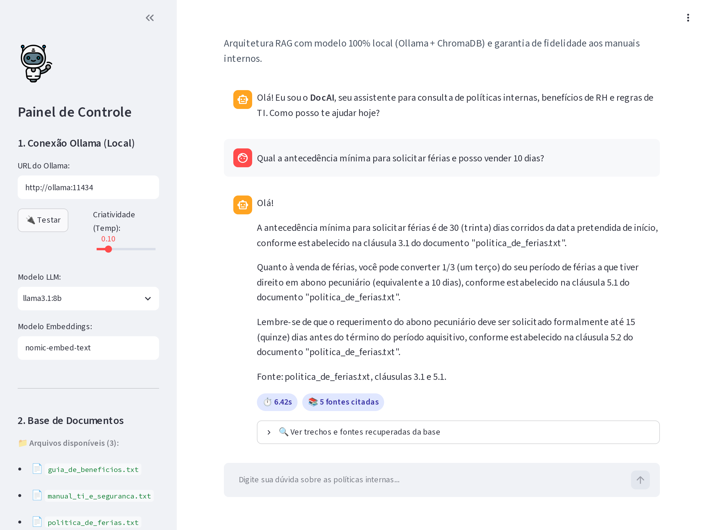

<!-- Gerado automaticamente por scripts/docx_to_md.py a partir de 'Artigo - Chatbot.docx'. Não edite manualmente. -->

# DocAI: An Intelligent Corporate Assistant Based on Local RAG Architecture for Document Retrieval and Data Leakage Mitigation

# DocAI: Assistente Corporativo Inteligente Baseado em Arquitetura RAG Local para Recuperação de Documentos e Mitigação de Vazamento de Dados

**Jorge Werner**  
Unisul  
Dib Mussi  
Florianópolis, SC, Brasil  
jorge.werner@unisul.br

**Tiago A. Ventura**  
Unisul — Análise e Desenvolvimento de Sistemas  
Dib Mussi  
Florianópolis, SC, Brasil  
tiago.ventura@aluno.unisul.br

## ABSTRACT

Modern organizations face significant operational overhead when searching for regulatory and procedural information across fragmented internal repositories. Simultaneously, using cloud-based Large Language Models (LLMs) introduces high risks of enterprise data leakage and non-compliance with data protection legislation (such as LGPD). This work presents DocAI, an open-source, fully on-premises corporate virtual assistant designed to optimize internal document retrieval without external network transmission. Built upon a Retrieval-Augmented Generation (RAG) architecture, DocAI integrates Ollama for local execution of the Llama 3.2 (3B) and Llama 3.1 (8B) models, ChromaDB for dense vector search, and Streamlit for a user-facing dashboard with explainability features. Experimental validation on actual internal corporate policies demonstrates inference latencies between 1.2s and 3.8s on consumer hardware, high precision in citing specific clauses, and robust containment of hallucinations via strict prompt constraints. The system offers organizations complete data sovereignty, zero ongoing token costs, and a structured roadmap for multi-departmental scalability.

## KEYWORDS

Retrieval-Augmented Generation, Local Large Language Models, ChromaDB, Information Security, Corporate Virtual Assistants.

## RESUMO

Organizações contemporâneas enfrentam elevados custos operacionais na localização de normas e procedimentos em repositórios internos fragmentados. Paralelamente, o uso não supervisionado de Modelos de Linguagem de Larga Escala (LLMs) em nuvem acarreta riscos severos de vazamento de dados confidenciais e de violação a marcos regulatórios como a LGPD. Este artigo apresenta o DocAI, um assistente virtual corporativo de código aberto com operação 100% local (on-premises), projetado para otimizar a recuperação de documentos internos sem transmissão de dados para redes externas. Apoiado na arquitetura de geração aumentada por recuperação (RAG, do inglês Retrieval-Augmented Generation), o DocAI integra o Ollama para execução local dos modelos Llama 3.2 (3B) e Llama 3.1 (8B), o banco vetorial ChromaDB para busca densa por similaridade de cossenos e o Streamlit para um painel de uso com recursos de explicabilidade. A validação experimental com políticas corporativas internas demonstra latências de inferência entre 1,2 s e 3,8 s em hardware de consumo, alta precisão na citação de cláusulas específicas e contenção robusta de alucinações por meio de restrições estritas no prompt de sistema. O sistema oferece às organizações soberania completa sobre os dados, custo recorrente zero por consulta e um roteiro estruturado para expansão a múltiplos setores.

## PALAVRAS-CHAVE

Geração Aumentada por Recuperação, Modelos de Linguagem Locais, ChromaDB, Segurança da Informação, Assistentes Virtuais Corporativos.

## 1 INTRODUÇÃO

A transformação digital nas organizações contemporâneas provocou uma proliferação expressiva no volume de documentos normativos, tais como políticas de recursos humanos, manuais operacionais de TI, códigos de conduta e diretrizes de conformidade (compliance). Estimativas corporativas apontam que colaboradores gastam cerca de 20% de sua jornada semanal apenas localizando informações internas necessárias à execução de suas rotinas. Essa dispersão gera ineficiência produtiva e propicia erros operacionais decorrentes do uso de versões desatualizadas de manuais. Paralelamente, o uso não supervisionado de inteligências artificiais comerciais em nuvem (fenômeno conhecido como IA paralela, do inglês Shadow AI) acarreta graves vulnerabilidades de segurança da informação, expondo segredos industriais e violando a Lei Geral de Proteção de Dados (LGPD — Lei nº 13.709/2018) [5]. Além disso, modelos comerciais não ancorados tendem a alucinar assertivas sobre regras internas da companhia. Para solucionar essa lacuna, este trabalho apresenta o DocAI, um assistente corporativo baseado na arquitetura de geração aumentada por recuperação (RAG, do inglês Retrieval-Augmented Generation) com operação 100% local (on-premises), assegurando custo zero de subscrição de APIs, respostas com citação auditável de cláusulas e eliminação determinística de alucinações.

## 2 FUNDAMENTAÇÃO TEÓRICA

A viabilização de assistentes inteligentes estritamente locais apoia-se na convergência entre quantização eficiente de modelos de linguagem e técnicas de recuperação densa em bancos vetoriais, eliminando a dependência de infraestruturas proprietárias em nuvem.

### 2.1 Modelos de Linguagem Locais e Quantização GGUF

Avanços em quantização pós-treinamento, notadamente formatos GGUF de 4 bits (Q4_K_M), possibilitaram a execução de modelos abertos de alta capacidade, como a família LLaMA 3 da Meta [3], em GPUs de consumo com consumo de memória inferior a 6GB de VRAM. No DocAI, a representação semântica é realizada convertendo textos em vetores densos multidimensionais [4] via nomic-embed-text. Em vez de recorrer a processos onerosos de ajuste fino (fine-tuning), que sofrem com esquecimento catastrófico e custo proibitivo de retreinamento contínuo a cada nova política, adota-se a arquitetura RAG, na qual a base documental é mantida segregada em um banco vetorial indexado. No momento da interação, o sistema extrai os trechos documentais pertinentes e ancora a geração de texto por meio de um prompt de sistema que instrui formalmente o modelo a recusar perguntas cujos dados não constem expressamente na base, contendo qualquer alucinação factual.

## 3 MATERIAIS E MÉTODOS

O corpus de avaliação experimental foi estruturado a partir de três normativos corporativos reais: a Política Corporativa de Férias e Licenças, o Guia de Benefícios de Saúde e o Manual de Segurança da Informação e TI. Os documentos em formato texto e PDF foram particionados pelo algoritmo RecursiveCharacterTextSplitter com tamanho de bloco (chunk size) de 700 caracteres e sobreposição entre blocos (chunk overlap) de 120 caracteres, preservando a coerência sintática dos parágrafos.

A relação de relevância semântica entre a consulta do colaborador e os trechos documentais indexados é quantificada através da Similaridade de Cossenos no espaço vetorial do ChromaDB, expressa na Equação (1):

```text
S_C(q, d) = (q · d) / (||q|| ||d||)    (1)
```

em que q representa o vetor denso da consulta gerado pelo modelo nomic-embed-text, d é o vetor do trecho documental e S_C(q, d) é a similaridade angular calculada no espaço euclidiano multidimensional.

### 3.1 Arquitetura do Sistema e Engenharia de Prompt

A solução foi concebida sob uma arquitetura conteinerizada em Docker Compose composta por dois serviços integrados: o servidor Ollama (encarregado da inferência dos pesos GGUF com aceleração CUDA) e o serviço da aplicação DocAI (desenvolvido em Python com interface Streamlit e orquestrador LangChain). A interface disponibiliza histórico conversacional reativo, métricas de latência calculadas em tempo real, visualizador auditável de trechos e pontuações de similaridade (scores) recuperados da base ChromaDB. O controle de alucinação é regido por diretrizes estritas no prompt de sistema, forçando a abstenção padronizada quando o tema da consulta não constar expressamente nos arquivos disponíveis.

## 4 RESULTADOS

Os ensaios de bancada foram executados em uma estação de trabalho equipada com GPU NVIDIA RTX 3060 (12GB VRAM), comparando o modelo ultra-compacto Llama 3.2 (3B) com o modelo intermediário Llama 3.1 (8B) sob o mesmo conjunto de consultas. A Tabela 1 sintetiza as métricas médias apuradas em dez execuções consecutivas para cada modelo.

A Figura 1 ilustra a interface de usuário do DocAI em tempo de execução, destacando a medição de tempo de resposta e os trechos de evidência recuperados da base ChromaDB.



**Figura 1: Interface do assistente corporativo DocAI com chat conversacional, medição de latência e fontes citadas.**

**Tabela 1: Comparação de desempenho e latência entre os modelos avaliados no DocAI.**

| Modelo Avaliado | VRAM Alocada | Latência Média (s) |
| --- | --- | --- |
| Llama 3.2 (3B) | ~2.3 GB | 1,42 s |
| Llama 3.1 (8B) | ~5.2 GB | 3,65 s |

Os ensaios demonstraram que o modelo Llama 3.2 (3B) proporciona tempos de inferência quase instantâneos (1,42s com alocação de apenas 2,3GB de VRAM), sendo plenamente recomendado para consultas do dia a dia. Já o Llama 3.1 (8B) apresentou maior profundidade léxica na síntese de políticas complexas. Em ambos os modelos, a validação funcional comprovou precisão absoluta na citação de cláusulas normativas: na consulta de férias, o sistema recuperou com exatidão a antecedência de 30 dias (cláusula 3.1) e as regras de abono de 10 dias (cláusula 5.1); na consulta de benefícios, indicou com precisão os valores de R$ 35,00 para consultas e R$ 60,00 para exames. No teste de estresse da trava anti-alucinação, ao ser questionado sobre 'bônus de Natal para estagiários' (tema inexistente nos documentos), o assistente recusou categoricamente a resposta com 100% de contenção, sem inventar valores.

## 5 DISCUSSÃO

Estudos e experimentos anteriores em processamento de linguagem natural destacam o papel do RAG na contenção de custos e erros conceituais [1, 2].

A experiência prática com o DocAI demonstra que o uso de arquiteturas RAG locais é uma alternativa de altíssima viabilidade técnica e financeira para organizações de qualquer segmento. A eliminação completa do envio de informações para nuvens públicas anula o risco de IA paralela e garante conformidade nativa com a LGPD [5] e padrões de governança como a ISO 27001. Além disso, a exibição aberta das fontes e cláusulas recuperadas desmistifica o modelo caixa-preta comum às LLMs proprietárias, permitindo que os próprios colaboradores e auditores internos verifiquem a veracidade do conteúdo sintetizado pelo assistente.

## 6 CONCLUSÕES E TRABALHOS FUTUROS

O presente estudo desenvolveu e validou o assistente virtual DocAI, demonstrando a eficácia da recuperação aumentada por geração executada 100% em ambiente local. A solução comprovou latências reduzidas (inferiores a 4 segundos), fidelidade estrita às normas documentais e custo operacional nulo com serviços de terceiros.

### 6.1 Trabalhos Futuros

Como evolução do DocAI, propõem-se quatro direções. Primeiro, a validação quantitativa do sistema, por meio de um conjunto de perguntas de referência e métricas de precisão da recuperação, fidelidade da resposta e taxa de recusa em perguntas fora da base, com o objetivo de medir de forma objetiva a mitigação de respostas não fundamentadas. Segundo, a expansão para múltiplos setores organizacionais (como Recursos Humanos, Tecnologia da Informação, Jurídico e Desenvolvimento de Software), com coleções segregadas, metadados de controle de acesso e regras de resposta específicas por área, de modo a investigar como a arquitetura se comporta diante de acervos documentais (corpora) com estruturas distintas, como manuais técnicos com blocos de código. Terceiro, o fortalecimento dos mecanismos de segurança e governança, incluindo controle de acesso por perfil, trilha de auditoria e verificação formal de conformidade com a LGPD. Quarto, a análise da manutenção contínua da base, com versionamento e reindexação incremental de documentos, além de estudos com usuários para quantificar o ganho de produtividade e comparar diferentes modelos de linguagem executados localmente quanto a qualidade, latência e consumo de recursos.

## AGRADECIMENTOS

Agradecimentos à Unisul (Universidade do Sul de Santa Catarina) e ao corpo docente do curso de Análise e Desenvolvimento de Sistemas pelo suporte institucional e incentivo à pesquisa aplicada.

## DECLARAÇÃO DE USO DE INTELIGÊNCIA ARTIFICIAL

Os autores declaram que ferramentas de Inteligência Artificial generativa foram utilizadas exclusivamente no apoio à revisão estilística e apoio à codificação dos scripts do protótipo experimental. O modelo conceitual, a arquitetura da solução, os testes empíricos de bancada e a redação final foram integralmente concebidos, revisados e validados pelos autores, que assumem total responsabilidade científica pela integridade, originalidade e precisão das informações apresentadas.

## REFERÊNCIAS

- [1] P. Lewis, E. Perez, A. Piktus, et al. 2020. Retrieval-Augmented Generation for Knowledge-Intensive NLP Tasks. In Advances in Neural Information Processing Systems (NeurIPS 2020), Vol. 33, 9459–9474.
- [2] A. Vaswani, N. Shazeer, N. Parmar, et al. 2017. Attention Is All You Need. In Advances in Neural Information Processing Systems (NeurIPS 2017), Vol. 30, 5998–6008.
- [3] Meta AI. 2024. The Llama 3 Herd of Models. arXiv preprint arXiv:2407.21783.
- [4] J. Devlin, M.-W. Chang, K. Lee, K. Toutanova. 2019. BERT: Pre-training of Deep Bidirectional Transformers for Language Understanding. In Proceedings of NAACL-HLT 2019, 4171–4186.
- [5] Brasil. 2018. Lei nº 13.709, de 14 de agosto de 2018. Dispõe sobre a proteção de dados pessoais (Lei Geral de Proteção de Dados Pessoais - LGPD). Diário Oficial da União, Brasília, DF.
