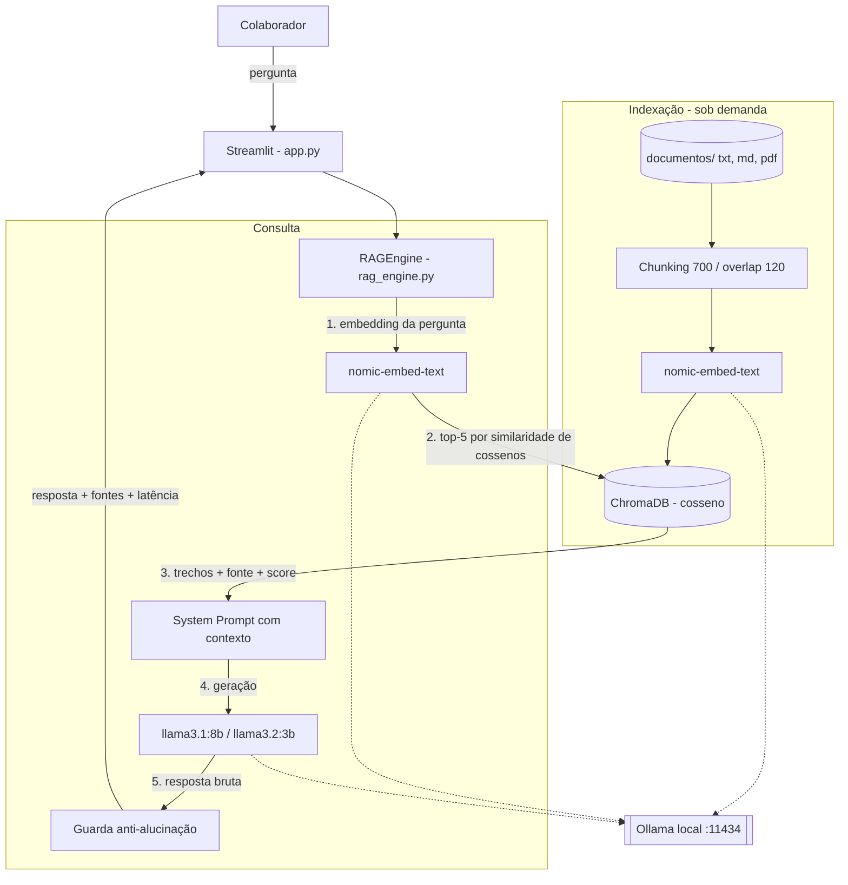

# DocAI: Assistente Corporativo Inteligente com RAG Local

[](https://github.com/TiagoFFC/DocAI-Corporate-RAG/actions/workflows/ci.yml)

> **Artigo científico e prova de conceito (MVP)**
> **Autores**: Tiago A. Ventura e Jorge Werner (orientador)
> **Instituição**: Unisul — Universidade do Sul de Santa Catarina, curso de Análise e Desenvolvimento de Sistemas
> **Artigo (Word, template SBC/Unisul)**: [Artigo/Artigo - Chatbot.docx](Artigo/Artigo%20-%20Chatbot.docx) · **Markdown**: [Artigo/ARTIGO_DOCAI.md](Artigo/ARTIGO_DOCAI.md)
> **Histórico do projeto**: [docs/HISTORICO_PROJETO.md](docs/HISTORICO_PROJETO.md) · **Guia para agentes de IA**: [AGENTS.md](AGENTS.md)

---

## 1. Visão geral

**Missão**: responder dúvidas de colaboradores sobre políticas internas (RH, benefícios, TI) usando apenas os documentos da empresa, citando fonte e cláusula, sem enviar nenhum dado para fora da rede.

O DocAI resolve três problemas:

1. **Produtividade**: o colaborador pergunta em linguagem natural em vez de procurar em manuais extensos.
2. **Privacidade (LGPD)**: modelo de linguagem, embeddings e base vetorial rodam localmente. Não há API externa nem chave de API.
3. **Alucinação**: perguntas fora da base recebem uma recusa padronizada, nunca uma resposta inventada.

| Camada | Tecnologia |
| --- | --- |
| Interface | Streamlit (porta 8501) |
| Orquestração RAG | LangChain |
| Base vetorial | ChromaDB, métrica de cosseno, persistida em `./chroma_db` |
| Embeddings | `nomic-embed-text` (Ollama) |
| LLM | `llama3.1:8b` (padrão) e `llama3.2:3b` (Ollama, porta 11434) |
| Empacotamento | Docker e Docker Compose |
| Linguagem | Python 3.11 |

---

## 2. Instalação rápida

### Opção A — Docker Compose (recomendada)

Pré-requisitos: Docker Desktop. Uma GPU NVIDIA com cerca de 12 GB de VRAM é recomendada; sem GPU, remova o bloco `deploy:` do `docker-compose.yml` (as respostas ficam bem mais lentas).

```bash
# 1. Subir Ollama + DocAI
docker compose up -d --build

# 2. Baixar os modelos (apenas na primeira vez; cerca de 7 GB)
docker exec ollama ollama pull nomic-embed-text
docker exec ollama ollama pull llama3.1:8b
docker exec ollama ollama pull llama3.2:3b
```

3. Abra **http://localhost:8501**.
4. Na barra lateral, clique em **⚡ Indexar Documentos no ChromaDB** (necessário na primeira execução e sempre que os documentos mudarem).

Para mudar portas, copie `.env.example` para `.env` e ajuste.

### Opção B — Manual com Python e venv

Pré-requisitos: Python 3.11 e [Ollama](https://ollama.com) instalado no sistema.

```bash
python -m venv .venv
# Windows: .venv\Scripts\activate      Linux/macOS: source .venv/bin/activate
pip install -r requirements.txt

ollama pull nomic-embed-text
ollama pull llama3.1:8b
ollama pull llama3.2:3b

streamlit run app.py
```

---

## 3. Arquitetura e fluxo de dados



```text
  [ Colaborador ] ──pergunta──▶ [ Streamlit · app.py · :8501 ]
                                          │
                                          ▼
                             [ RAGEngine · rag_engine.py ]
                               │                      │
              1. embedding     │                      │  4. prompt + contexto
              2. busca top-5   ▼                      ▼
                     [ ChromaDB · ./chroma_db ]   [ Ollama · :11434 ]
                       métrica: cosseno            ├─ nomic-embed-text
                               │                   └─ llama3.1:8b / llama3.2:3b
              3. trechos, fonte e score                 │
                               └──────────┬─────────────┘
                                          ▼
                         5. Guarda anti-alucinação (determinística)
                                          │
                                          ▼
                       resposta + fontes citadas + latência

  Indexação:  documentos/*.txt|md|pdf ─▶ chunks (700/120) ─▶ embeddings ─▶ ChromaDB
```

Parâmetros: chunks de 700 caracteres com sobreposição de 120 (21 trechos no corpus atual); recuperação dos 5 trechos mais similares após remover redundâncias; temperatura padrão 0,1. O score exibido é a similaridade de cossenos `S_C(q, d) = (q · d) / (||q|| ||d||)`, a Equação (1) do artigo.

---

## 4. Prompt de sistema e guardrails

O prompt está em `SYSTEM_PROMPT`, em [rag_engine.py](rag_engine.py):

```text
Você é o Assistente Virtual Corporativo (DocAI) de uma empresa.
Sua missão é responder à dúvida do colaborador baseando-se ESTRITAMENTE nos trechos
de documentos fornecidos no contexto abaixo.

REGRAS OBRIGATÓRIAS DE RESPOSTA:
1. Responda APENAS com base nos trechos fornecidos no CONTEXTO. Se a pergunta contiver
   múltiplos itens, responda a cada item com base nas cláusulas correspondentes.
2. Se a informação solicitada (ou parte dela) NÃO constar expressamente nos documentos,
   indique com precisão o que consta e, para o que não constar, informe:
   "Essa informação não consta nas políticas e manuais internos disponíveis na minha base.
   Recomendo abrir um chamado junto ao setor responsável (Gente & Gestão ou TI)."
   Se NENHUMA parte da pergunta puder ser respondida com o contexto, responda SOMENTE
   com essa frase.
3. NUNCA invente, presuma, extrapole ou deduza regras que não estejam escritas no texto.
4. Sempre mencione o nome do documento fonte e o número da seção ou cláusula.
5. Mantenha um tom profissional, cordial, claro e objetivo em português do Brasil.

CONTEXTO DOS DOCUMENTOS INTERNOS: {context}
PERGUNTA DO COLABORADOR: {question}
```

Guardrails em vigor:

| Guardrail | Onde | O que faz |
| --- | --- | --- |
| Grounding | `SYSTEM_PROMPT` | O modelo só pode usar os trechos recuperados |
| Recusa padrão | `REFUSAL_MESSAGE` | Texto único e fixo para o que não está na base |
| Guarda pós-geração | `apply_refusal_guard()` | Se a resposta sinaliza ausência e não cita documento nem cláusula, é substituída pela recusa exata. É código determinístico, não depende do modelo |
| Citação obrigatória | Regra 4 do prompt | Documento e cláusula em toda resposta |
| Auditabilidade | Interface | Trechos, arquivo de origem e score visíveis ao usuário |
| Temperatura baixa | `ask(temperature=0.1)` | Reduz variação entre respostas |
| Isolamento | Docker Compose | Nenhuma chamada externa |

---

## 5. Testes

A suíte [tests/test_rag_pipeline.py](tests/test_rag_pipeline.py) tem 30 testes em 5 grupos:

| Grupo | Valida |
| --- | --- |
| 1. Conectividade | Ollama responde e os três modelos estão instalados |
| 2. Ingestão | Leitura dos três documentos, chunking e persistência no ChromaDB |
| 3. Recuperação | Fonte e cláusula corretas no topo; score igual à fórmula do cosseno |
| 4. Geração | Férias (cláusulas 3.1 e 5.1), coparticipação (R$ 35,00 e R$ 60,00), furto de notebook (B.O. em 24 h e aviso à TI) |
| 5. Anti-alucinação | "Qual é o valor do bônus de Natal para estagiários?" retorna estritamente a recusa padrão, nos dois modelos |

Os testes usam uma base vetorial temporária e não alteram `./chroma_db`.

```bash
pip install -r requirements-dev.txt

python -m pytest tests/                   # suíte completa (exige Ollama com os modelos)
python tests/test_rag_pipeline.py         # equivalente
python -m pytest tests/ -m "not ollama"   # apenas os 10 testes offline (usado no CI)
```

Se o Python só existir dentro do Docker, rode a partir da raiz do projeto, com os containers no ar:

```bash
docker run --rm --network chatbot_default -e OLLAMA_BASE_URL=http://ollama:11434 \
  -v "$PWD:/workspace" -w /workspace --entrypoint bash chatbot-docai-chatbot \
  -c "pip install -q -r requirements-dev.txt && python -m pytest tests/"
```

Auditoria do artigo (placeholders, elementos obrigatórios e paridade Word × Markdown):

```bash
python scripts/verify_docx.py "Artigo/Artigo - Chatbot.docx"
```

Outros utilitários: `scripts/docx_to_md.py` regenera o Markdown a partir do Word; `scripts/benchmark_latency.py` mede a latência por modelo.

---

## 6. Roteiro de demonstração para a banca (4 passos)

Antes de começar: suba os containers e faça uma pergunta qualquer para aquecer o modelo. A primeira resposta após a inicialização demora, pois carrega os pesos na GPU.

**Passo 1 — Mostrar que é local.** Na barra lateral, clique em **🔌 Testar** (Ollama online) e aponte os três documentos em `documentos/`: `politica_de_ferias.txt`, `guia_de_beneficios.txt` e `manual_ti_e_seguranca.txt`.

**Passo 2 — Indexar.** Clique em **⚡ Indexar Documentos no ChromaDB** e explique: os textos viram 21 trechos de até 700 caracteres, cada um convertido em vetor.

**Passo 3 — Três perguntas respondidas com citação** (botões prontos na barra lateral). Em cada uma, abra **🔍 Ver trechos e fontes recuperadas** para mostrar o trecho e o score de similaridade.

| Botão | Pergunta | Resposta esperada |
| --- | --- | --- |
| 🏖️ Férias e Abono | Qual a antecedência mínima para solicitar férias e posso vender 10 dias? | 30 dias corridos (cláusula 3.1); conversão de 1/3 em abono, equivalente a 10 dias (cláusula 5.1) |
| 🏥 Coparticipação | Como funciona a coparticipação em consultas e exames no plano de saúde? | R$ 35,00 por consulta eletiva; R$ 60,00 por exame complexo (seção 2.5) |
| 💻 Furto de Notebook | O que devo fazer caso meu notebook corporativo seja roubado? | Registrar B.O. em até 24 horas, avisar a TI em `security@empresa.com.br` e abrir chamado no ServiceDesk (cláusula 2.3) |

**Passo 4 — A pegadinha (ponto alto).** Clique em **⚠️ Pegadinha** — *"Qual é o valor do bônus de Natal pago para estagiários?"*. O DocAI responde exatamente:

> Essa informação não consta nas políticas e manuais internos disponíveis na minha base. Recomendo abrir um chamado junto ao setor responsável (Gente & Gestão ou TI).

Destaque que um assistente genérico tenderia a inventar um valor plausível, e que aqui a recusa é garantida por código, não apenas pelo prompt.

Use `llama3.1:8b` (padrão) na demonstração: o `llama3.2:3b` é mais rápido, mas erra a pergunta composta de férias.

---

## 7. Estrutura do repositório

```text
DocAI/
├── .github/workflows/ci.yml    # CI: auditoria do artigo + testes offline
├── Apresentação/               # Roteiro de pitch e levantamento de viabilidade
├── Artigo/
│   ├── Artigo - Chatbot.docx   # Artigo oficial (fonte única da verdade)
│   ├── ARTIGO_DOCAI.md         # Transcrição gerada do Word (não editar à mão)
│   └── figura1_interface_docai.png
├── docs/HISTORICO_PROJETO.md   # Histórico executivo e changelog
├── documentos/                 # Políticas e manuais (corpus do RAG)
├── scripts/                    # verify_docx, docx_to_md, benchmark_latency
├── tests/                      # Suíte automatizada do pipeline RAG
├── app.py                      # Interface Streamlit
├── rag_engine.py               # Motor RAG e trava anti-alucinação
├── Dockerfile
├── docker-compose.yml
├── requirements.txt            # Dependências de produção
├── requirements-dev.txt        # Dependências de testes e auditoria
├── .env.example
├── AGENTS.md                   # Regras para agentes de IA
└── README.md
```

`chroma_db/` é criada pela indexação e não é versionada.

---

## 8. Limitações

- O corpus são três documentos fictícios da "Empresa Exemplo S.A."; a validação é funcional, não um benchmark estatístico.
- A latência depende do hardware e do tamanho da resposta. O artigo reporta 1,42 s (3B) e 3,65 s (8B); a medição de conferência desta versão está em [docs/HISTORICO_PROJETO.md](docs/HISTORICO_PROJETO.md).
- A indexação recria a base inteira a cada execução.
- Não há autenticação nem controle de acesso por perfil.

Esses pontos correspondem às quatro direções de trabalhos futuros descritas no artigo.
